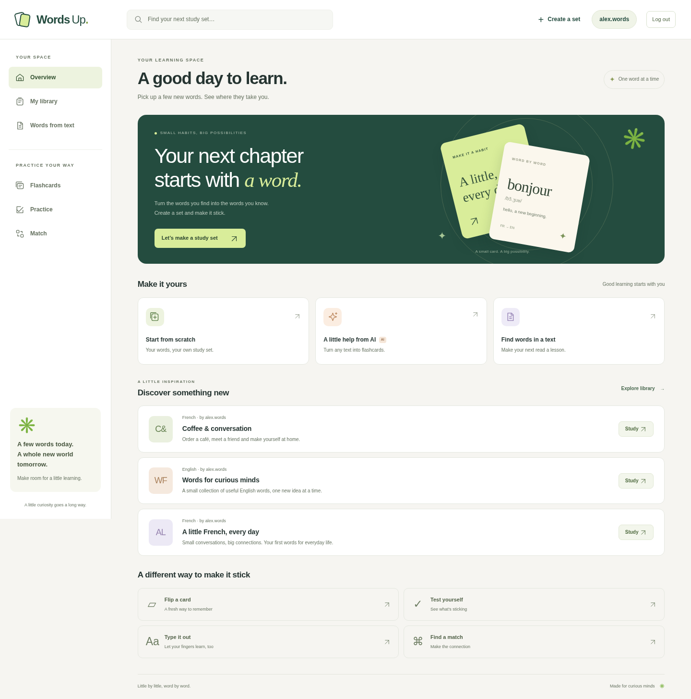

# Words Up · FlashCards

A Java/Spring Boot application for studying English and French vocabulary with Russian definitions. Create public or private collections, practise with flashcards, typing and matching, and turn text or PDFs into vocabulary exercises.



[Set editor](docs/images/editor.png) · [Flashcard practice](docs/images/study.png). Screenshots use synthetic demonstration data.

Demo: [wordsup.eu](https://wordsup.eu). The deployed version is managed separately from this repository; see [deployment](#deployment).

## What works

- Registration, JWT login, logout with server-side session revocation, and owner-only editing.
- Public collections, private libraries, paginated search, and several study modes that retain the selected collection.
- Browser drafts and explicit local/account save status; failed online saves keep the draft for retry.
- Small raster images and diagrams saved with account collections; per-user drawing annotations.
- English/French typing practice, PDF text extraction, optional dictionary, AI and pronunciation integrations.
- PostgreSQL/Flyway migrations, backend regression tests, browser regressions and GitHub Actions.

This is a portfolio application with documented limits, not a claim of production-scale operation. Password recovery is **disabled** until a verified email-delivery flow is implemented. Core collections and practice work without external API keys.

## Quick start with Docker

Requires Docker Engine/Desktop with Compose and Python 3. Neither a local JDK nor Node is needed to run the containerized application.

```sh
python3 scripts/init-env.py
# Windows: py scripts/init-env.py
# Creates a private .env with random database and JWT secrets; never overwrites it.
docker compose --profile app up --build -d
```

Open **http://localhost:8080**. Flyway applies migrations automatically. The Docker build packages HTML, CSS and JavaScript inside the executable JAR. Application and database ports bind to loopback by default.

```sh
docker compose logs -f app
docker compose --profile app down
```

`down` retains the database volume. Do not remove volumes to upgrade or refresh the application. Changing `DB_PASSWORD` in `.env` does not automatically change the password of an existing PostgreSQL volume: rotate the role's password deliberately and update the matching configuration.

## Local development

Requires **JDK 24 or newer**, Docker/Compose and Python 3. Maven **3.9.9** is supplied by the wrapper. The compiler targets Java 24; no separate Maven installation is needed. Node 22+ is only needed to run frontend tests.

```sh
python3 scripts/init-env.py
docker compose up -d --wait postgres
sh ./mvnw -B -ntp verify
bash scripts/run-local.sh
```

PowerShell:

```powershell
py scripts/init-env.py
docker compose up -d --wait postgres
.\mvnw.cmd -B -ntp verify
Get-Content .env | Where-Object { $_ -match '^[A-Z_]+=' } | ForEach-Object {
    $name, $value = $_ -split '=', 2
    [Environment]::SetEnvironmentVariable($name, $value, 'Process')
}
java -jar target/flash-0.0.1-SNAPSHOT.jar
```

The application listens on **8080**. Static files in the checkout take priority for frontend development; the packaged classpath copy is used when `front/` is absent. Rebuild the JAR after Java changes or before deployment. Create sample collections through the UI; no user database dump is required.

## Configuration

`.env` and local secrets are ignored by Git and excluded from Docker's build context. Generate values with the helper for local development; production values belong in your deployment platform's secret configuration. Do not paste credentials into issues, logs or documentation.

| Variable | Purpose |
| --- | --- |
| `DB_USER`, `DB_NAME`, `DB_PASSWORD` | Local Compose PostgreSQL configuration |
| `DB_URL` | Optional JDBC override; default `jdbc:postgresql://localhost:5432/quizlet_db` |
| `JWT_SECRET` | Required base64-encoded random signing key, at least 32 decoded bytes; helper generates 64 bytes |
| `APP_PORT` | Optional host port for the application container; default 8080 |
| `DEEPSEEK_API_KEY` | Optional AI card and sentence generation |
| `YANDEX_DICTIONARY_API_KEY` | Optional dictionary lookup |
| `FORVO_API_KEY` | Optional pronunciation lookup; browser speech remains available |

The JVM does not read `.env` by itself. Compose, `scripts/run-local.sh`, and the test runner load it. External API values default to empty, never to published credentials. See [security and secret rotation](docs/SECURITY.md).

## Verification

```sh
# Fast backend suite on H2
sh ./mvnw -B -ntp verify

# Same suite on a fresh PostgreSQL 16 database, including Flyway and schema validation
python3 scripts/check.py postgres

# Persistent frontend regressions
npm ci
npx playwright install chromium
npm run test:unit
python3 scripts/check.py e2e
```

`check.py` creates its own database, preserves the development database, and removes its test database/process on completion or failure. It requires Docker/Compose and `.env`. PostgreSQL checks build the JAR; run them or `verify` before E2E after backend changes. For an already installed system Chromium, set `PLAYWRIGHT_CHROMIUM_EXECUTABLE_PATH` to its executable. Failure diagnostics are written under ignored `artifacts/` and `test-results/`.

CI runs H2, PostgreSQL and Chromium checks and builds the Docker application image. The browser suite covers draft recovery, collection navigation, image/diagram persistence in a new session, failed saves, login/logout, paginated search, suggestions, timers, card ordering and responsive layouts. See the dated [local verification results](docs/VERIFICATION.md).

## API essentials

Bearer tokens go in `Authorization: Bearer <token>`. Errors use one JSON structure with `status`, `message`, `path` and optional `fieldErrors`. No endpoint returns a password or reset token.

| Method | Path | Behavior |
| --- | --- | --- |
| POST | `/api/auth/signup`, `/api/auth/login` | Create account / obtain token; rate limited |
| POST | `/api/auth/logout` | Revoke all outstanding tokens for the signed-in account |
| POST | `/api/auth/forgot-password`, `/api/auth/reset-password` | 503; recovery is intentionally unavailable |
| GET | `/api/users/{username}` | Public ID and username; no email |
| GET | `/api/sets/public` | Public collection summaries |
| GET | `/api/sets/me` | Signed-in user's summaries |
| GET | `/api/sets/user/{username}` | Own collections or another user's public summaries |
| GET | `/api/sets/{id}` | Owner's editable metadata and diagram |
| GET | `/api/sets/{id}/study` | Public metadata or owner's private metadata |
| POST / PUT / DELETE | `/api/sets`, `/api/sets/{id}` | Owner-authorized collection operations |
| GET / POST | `/api/flashcards/set/{id}` | Read visible cards / owner adds card |
| DELETE | `/api/flashcards/{id}` | Owner deletes card |
| GET / PUT | `/api/annotations/card/{id}` | Current user's drawings on a visible card |
| POST | `/api/documents/pdf-text` | Authenticated multipart PDF extraction |
| POST | `/api/ai/create-set`, `/api/ai/example`, `/api/dictionary/lookup` | Authenticated optional integrations |
| GET | `/api/pronunciation` | Authenticated optional pronunciation lookup |

List endpoints accept `page` (zero-based), `size` (1–100, default 24), and `q` (up to 100 characters). Bodies remain JSON arrays; `X-Has-More` and `X-Total-Count` describe pagination. Card images are PNG/JPEG/WebP data URLs, at most 300,000 characters each and 2,000,000 characters per collection. The editor resizes/uploads small raster images; SVG and arbitrary image URLs are rejected.

## Deployment

1. Supply unique production `JWT_SECRET` and database credentials securely. Rotate previously published credentials; do not reuse local development secrets.
2. Build and run the Docker application, or run the packaged JAR with the environment configured. The JAR contains the frontend.
3. Terminate HTTPS at a trusted reverse proxy pointing to the application. CORS allows localhost development and `wordsup.eu`/`www.wordsup.eu`; review origins for another host. Authentication limits use the server-observed remote address; do not trust arbitrary forwarding headers.
4. Back up PostgreSQL before upgrades, apply the new application/migrations, and verify `/api/sets/public` plus a real sign-in/save flow. Code pushes and environment configuration saves do not deploy the public site by themselves.

Changing the JWT signing key revokes old sessions. An existing database upgrades through additive Flyway migrations; the unsafe password-reset endpoints remain disabled regardless of old reset records. Secrets previously present in Git must be revoked at their providers; deleting code does not revoke a credential.

## Structure and tradeoffs

```text
front/                 HTML pages, shared API/storage/navigation helpers and feature modules
src/main/java/         Security, controllers, application services, repositories and DTOs
src/main/resources/db/ Versioned Flyway migrations
src/test/              Backend behavior and security regressions
scripts/               Private local configuration and disposable integration-test runners
tests/                 Browser and frontend storage regressions
docs/                  Architecture, security, screenshots and review follow-up
```

Read [architecture](docs/ARCHITECTURE.md), [known limitations](docs/ARCHITECTURE.md#limits), and the [review follow-up](docs/REVIEW-FOLLOWUP.md). The project deliberately keeps one Spring Boot application and a small JavaScript frontend; a distributed architecture is unnecessary for its current scope.
