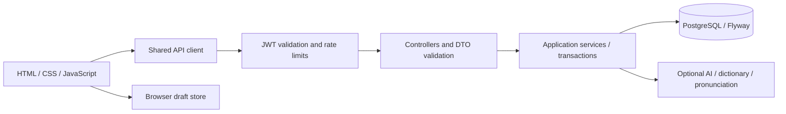

# Architecture

Words Up is one deployable Spring Boot application. The JAR contains the static frontend and serves JSON APIs. PostgreSQL stores accounts, collections, cards, image data, user-specific drawings and pronunciation cache records.

## Data and access

An account owns collections; each collection contains cards with stable client IDs and an explicit stored position. Updates match those IDs so reordering survives reload and does not erase card identity and annotations. Set creation/update happens in a service transaction; invalid image/update data rolls the operation back. Public and owner-only routes have separate access checks, including the per-user listing route. Public profile DTOs omit email and password.

JWTs contain the account's session version. Each authenticated request validates the signature, expiration and current account version. Logout atomically increments that version, invalidating all existing tokens for the account. Missing signing configuration stops startup. Password recovery has no active token-issuing endpoint.

## Browser state

`app-client.js` centralizes base URL, bearer requests, request timeouts and readable API failures. `draft-store.js` owns safe draft serialization and consumes `new=1` once. `study-navigation.js` propagates the chosen collection between modes. Images are resized/encoded in `app-images.js`; editor suggestions and study timers keep their state in separate closures.

Guest sets stay in browser storage. Account saves go to PostgreSQL; a failed online save is reported as a failure and never silently converted into an account save. The draft remains available when browser storage permits. A fresh browser context can reopen saved image data, which is covered by E2E tests.

## Integrations and limits

HTTP clients use connect/request timeouts; dictionary lookup also has one overall 15-second budget across a batch, rather than multiplying a full timeout by every word. The request DTO caps a dictionary batch at 50 words. Forvo persists positive and negative lookups with separate TTLs. Provider failures remain visible; automated tests use local fixtures rather than paid APIs.

Collection summaries are paginated and searched on the server. Owner associations are fetched with list queries to avoid one owner lookup per displayed collection. Large image/diagram payloads are omitted from summaries and are returned only when opening an individual collection/card list.

## Limits

- Password recovery awaits verified email delivery, neutral responses, one-time hashed reset tokens and revocation tests. It stays disabled until that entire flow exists.
- Rate limits and browser storage are designed for a single application instance. Multiple instances need a shared limiter. Trusted reverse-proxy address handling must be configured for the deployment.
- Images are bounded data URLs in PostgreSQL to keep this application self-contained. Larger workloads should use object storage and explicit upload lifecycle/quota handling.
- Collection edits currently use last-write-wins semantics; concurrent editing does not have an optimistic-lock conflict UI yet.
- AI and dictionary services are optional and require the owner's provider accounts and valid keys. No automated test calls a paid provider.
- The compiler targets Java 24. A move to a chosen LTS toolchain should be made and tested as a separate compatibility change.
- Some legacy styling/rendering remains, but API/storage/navigation, suggestions and timer state have dedicated modules. Continue consolidation as those features change, without a wholesale framework rewrite.
- This repository demonstrates a portfolio application, not measured production throughput or availability. No load or penetration-test certification is claimed.
